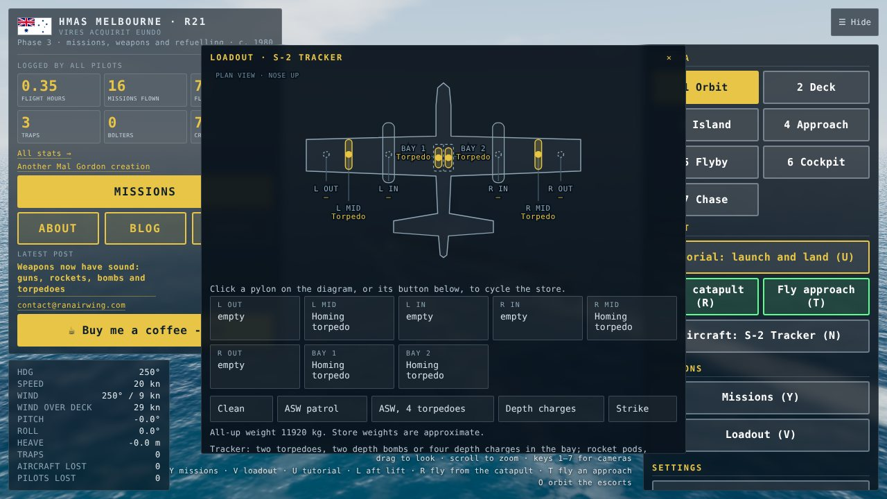

The loadout screen used to be a row of buttons. It now draws the aircraft from above, nose up, with each pylon marked, so you can see where a store hangs before you apply it.

## What it shows

- **Skyhawk:** five stations (left outer, left inner, centreline, right inner, right outer).
- **Tracker:** six wing points plus the two bay positions, drawn inside a dashed bay outline.
- A loaded pylon is filled in the accent colour with a store shape sized by type (tank, pod, bomb, missile, torpedo) and a short label. An empty pylon is a dashed circle.
- Presets and the station buttons below update the diagram at once.

## Try it

Press <kbd>V</kbd> for the loadout screen. Click a pylon on the diagram, or its button, to step through the stores that station accepts. <kbd>N</kbd> switches between the Skyhawk and the Tracker.

## Still approximate

The outlines are simple schematic shapes, not scale drawings. Store shapes show type and rough size only. Station positions follow the sim's own model: the Tracker is drawn with two wing points per side outboard plus an inner point on each engine nacelle, and the sources say six wing points in total, so that spacing is an estimate. Bay doors are still not modelled, so bay stores are drawn on the diagram but not on the airframe until released.
